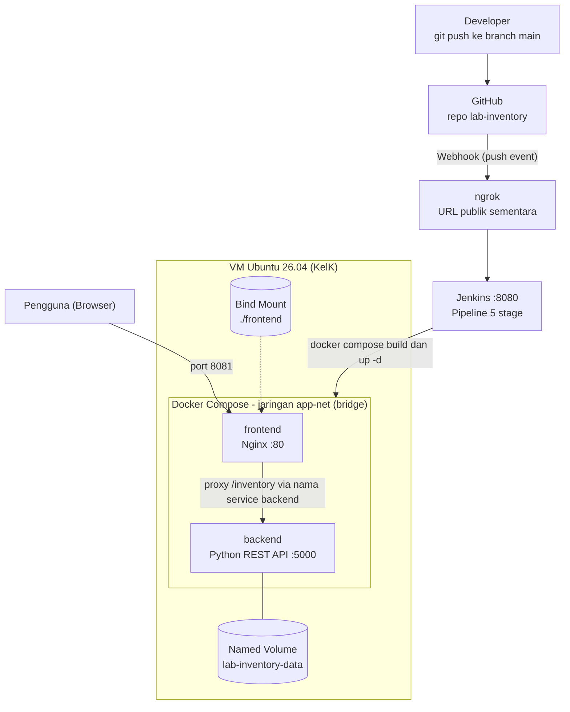

# Lab Inventory Catalog - Chunin Exam (UTS Cloud Computing)

Aplikasi fullstack sederhana untuk mencatat peminjaman dan ketersediaan alat laboratorium (Mikrotik, Modem, Kabel), dijalankan dengan Docker Compose dan di-deploy otomatis oleh Jenkins setiap ada `git push`.

## Identitas Kelompok

**Kelompok K**

| Nama | NIM |
|---|---|
| Afif Alim Mufid      | 101012430020 |
| Ahmad Faisal Hafidz  | 101012300379 |
| Faris Nadhif Ashari  | 101012400108 |

**Studi kasus:** Inventaris Barang Laboratorium (Lab Inventory Catalog)

## Arsitektur



Ringkasan:
- **Frontend** (Nginx) menampilkan `index.html` dari **Bind Mount**, sehingga perubahan tampilan langsung terlihat tanpa rebuild image.
- **Backend** (Python, tanpa framework) menyimpan data di `inventory.json` di dalam **Named Volume** `lab-inventory-data`, jadi data tetap aman bahkan jika kontainer dihapus.
- Keduanya berada di **Custom Bridge Network** `app-net` dan saling berkomunikasi melalui nama service (DNS Docker).

## Struktur Repository

```
lab-inventory/
├── app.py                # Backend REST API
├── Dockerfile            # Image Backend
├── docker-compose.yml    # Definisi seluruh stack
├── nginx.conf            # Konfigurasi Nginx (proxy ke backend)
├── Jenkinsfile           # Pipeline CI/CD 5 stage
├── frontend/
└──   └── index.html        # Tampilan web (HTML + Vanilla JS)
```

## Endpoint API

| Method | Endpoint | Fungsi | Respons |
|---|---|---|---|
| GET | `/inventory` | Daftar semua alat | 200 |
| POST | `/inventory` | Tambah alat baru | 201, atau 400 jika data tidak valid |
| DELETE | `/inventory?index=X` | Hapus alat urutan ke-X | 200, 400 jika index salah, 404 jika tidak ada |
| GET | `/health` | Cek Backend hidup | 200 |

Contoh body POST:
```json
{"name": "Mikrotik hAP ac2", "category": "Mikrotik", "quantity": 2, "status": "Tersedia", "borrower": ""}
```
Nilai `status`: `Tersedia`, `Dipinjam`, atau `Rusak`.

## Instalasi Lokal

Syarat: Docker dan Docker Compose.

```bash
git clone https://github.com/Api1pp/lab-inventory.git
cd lab-inventory
docker compose up -d --build
```
Buka **http://localhost:8081**. Untuk menghentikan: `docker compose down` (data tetap tersimpan di volume).

## Pengujian

**Data Immunity** (data aman saat kontainer dihapus):
```bash
docker rm -f lab-backend
docker compose up -d
curl http://localhost:8081/inventory   # data masih ada
```

**Bind Mount:** ubah `frontend/index.html`, lalu muat ulang browser. Tampilan berubah tanpa rebuild image.

## Setup Jenkins dan CI/CD

1. **Pasang Jenkins** di VM (Java 21 + paket Jenkins LTS), lalu tambahkan user `jenkins` ke grup `docker`:
   ```bash
   sudo usermod -aG docker jenkins && sudo systemctl restart jenkins
   ```
2. **Credential GitHub:** buat Personal Access Token (izin `repo` dan `admin:repo_hook`), lalu tambahkan di *Manage Jenkins > Credentials* (Kind: Username with password, ID: `github-pat`).
3. **Pipeline job** `lab-inventory-pipeline`: Definition *Pipeline script from SCM*, SCM Git, URL repo ini, branch `*/main`, Script Path `Jenkinsfile`. Centang *GitHub hook trigger for GITScm polling*.
4. **Webhook GitHub:** karena VM berada di balik NAT, Jenkins diekspos sementara dengan ngrok (`ngrok http 8080`). Di *Settings > Webhooks* isi Payload URL `https://<alamat-ngrok>/github-webhook/`, content type `application/json`, event `push`.

Tahapan pipeline (`Jenkinsfile`):

| Stage | Fungsi |
|---|---|
| Checkout | Mengambil kode terbaru dari GitHub |
| Syntax Check | Memeriksa `app.py` dan `docker-compose.yml` |
| Build Image | Membangun image Backend |
| Automated Deployment | Menjalankan ulang stack dengan `docker compose up -d` |
| Health Check | Memastikan Backend dan Frontend menjawab |

## Bukti Pengerjaan

| Bukti | Gambar |
|---|---|
| Docker terpasang |  |
| Kontainer berjalan |  |
| Tampilan web |  |
| Named Volume dan Network |  |
| Data Immunity |  |
| Pipeline Jenkins hijau |  |
| Webhook terkirim |  |
| Auto-deploy: tampilan berubah |  |

## Troubleshooting

1. **SSH: "REMOTE HOST IDENTIFICATION HAS CHANGED"**: port lokal pernah dipakai VM lain. Jalankan `ssh-keygen -R "[127.0.0.1]:2222"`.
2. **`git push` gagal dari terminal VS Code (ECONNREFUSED ...vscode-git...sock)**: sesi terminal lama. Jalankan `unset GIT_ASKPASS VSCODE_GIT_ASKPASS_NODE VSCODE_GIT_ASKPASS_MAIN VSCODE_GIT_ASKPASS_EXTRA_ARGS VSCODE_GIT_IPC_HANDLE`, lalu push lagi.
3. **`Conflict. The container name is already in use`**: nama proyek Compose berbeda. Pastikan baris `name: lab-inventory` di `docker-compose.yml` benar.
4. **Jenkins gagal diinstal (kunci apt)**: tutorial lama memakai kunci 2023. Gunakan `jenkins.io-2026.key`.
5. **Webhook GitHub menampilkan 403**: Hal ini dikarenakan terjadi Error not found atau tidak ada data yang terdefinisi sehingga gagal reachout

## Video Demo

https://drive.google.com/file/d/1RihAQCXFv9QRf8p2jjda1Bp57jQO1k30/view?usp=sharing
